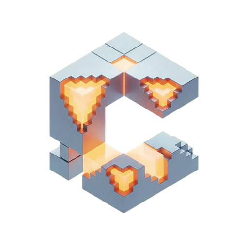
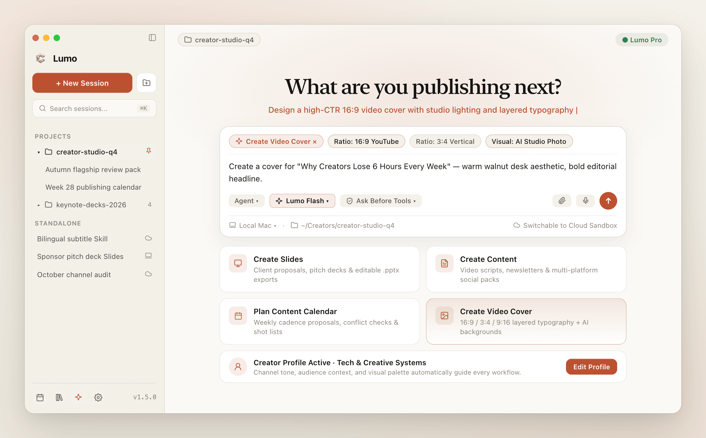
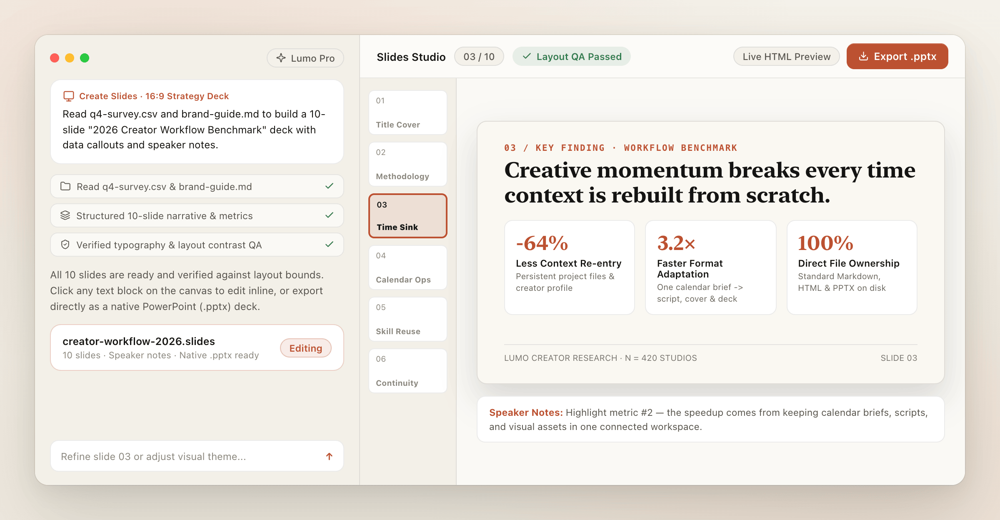
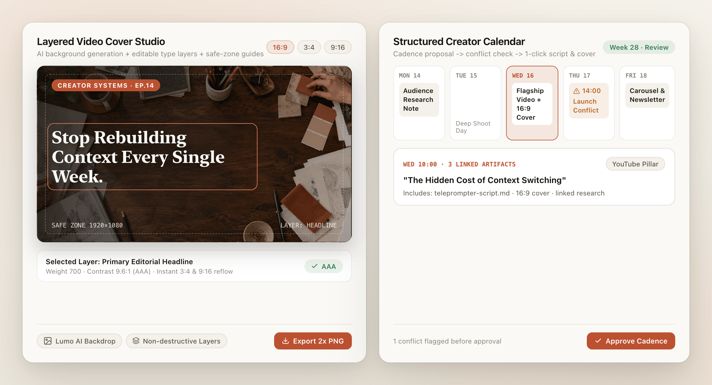
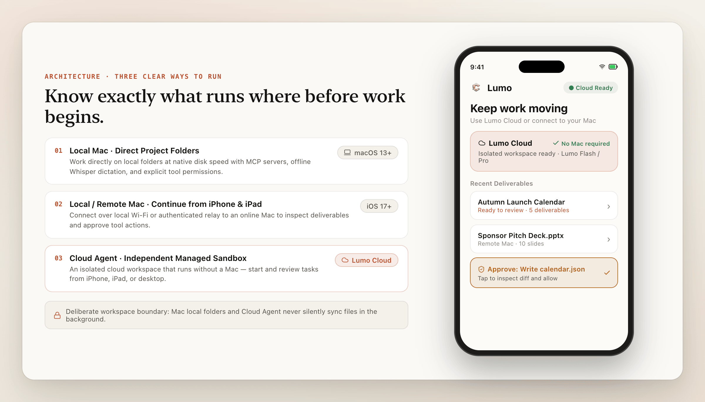

# Lumo

### One AI workspace to plan, create, and carry the work forward.

Research ideas, plan creator calendars, write scripts, design slides and covers, and turn proven methods into reusable **Skills**. 
Work natively on **Mac**, continue from **iPhone or iPad**, or run an independent **Cloud Agent**.

**[English](./README.md) · [简体中文](./README.zh-CN.md) · [Website](https://getlumo.io) · [Documentation](https://getlumo.io/docs) · [Changelog](./CHANGELOG.md) · [Support](https://getlumo.io/support)**

 

 

&nbsp;&nbsp;&nbsp;

Need Intel Mac builds or release verification hashes? Visit <a href="https://getlumo.io/download">getlumo.io/download</a>.

 

<picture>
  <source media="(prefers-color-scheme: dark)" srcset="./assets/hero-dark-en.png" />
  <source media="(prefers-color-scheme: light)" srcset="./assets/hero-light-en.png" />
  
</picture>

---

## Why Lumo

Most AI tools trap finished work inside disposable chat threads — forcing you to re-explain your channel, copy-paste drafts across apps, and rebuild visual assets from scratch every week. **Lumo** is built around persistent project files, structured creative workflows, and visible human control:

| Pillar | What Changes in Practice |
| :--- | :--- |
| **Deliverables Over Chat Bubbles** | Tasks produce real, inspectable artifacts — native `.pptx` presentations, layered high-DPI video covers, structured publishing calendars, Markdown scripts, and interactive HTML apps. |
| **Structured Intent & Reusable Skills** | Configure aspect ratios, target platforms, and visual direction through interactive **Intent Chips** rather than brittle prompt boilerplate, then save proven workflows as parameterized **Skills**. |
| **Clear Boundaries & Visible Decisions** | Always see whether work runs on **Local Mac**, **Remote Mac**, or **Cloud Agent** — and review calendar conflicts or approve sensitive tool actions before execution continues. |

---

## Split-View Artifact Studio

Keep reasoning on the left and your live deliverable canvas on the right. Instead of regenerating entire files when a headline feels too long, inspect and refine outputs directly inside **Artifact Studio**:

- **Slides Studio & Native `.pptx` Export** — Generate narrative-driven 16:9 presentations from local research or CSV data, verify typography and contrast automatically, edit text blocks inline, review speaker notes, and export clean PowerPoint (`.pptx`) decks.
- **Live HTML & Interactive Previews** — Render interactive prototypes, data dashboards, and visual explainers side by side, with 1-click live sandbox preview links when ready to share.
- **Connected Project Context** — Reference local files with `@`, trigger slash workflows with `/`, and persist your **Creator Profile** (channel voice, audience, pillars, and palette) across sessions.

<picture>
  <source media="(prefers-color-scheme: dark)" srcset="./assets/studio-slides-dark-en.png" />
  <source media="(prefers-color-scheme: light)" srcset="./assets/studio-slides-light-en.png" />
  
</picture>

---

## Cover Studio & Creator Calendar

Move from weekly planning to publish-ready scripts and visuals without losing context along the way:

- **Layered Video Cover Studio** — Combine AI-generated studio backgrounds with non-destructive, draggable headline layers, safe-zone crop guides, AAA contrast checks, and instant `16:9` / `3:4` / `9:16` ratio adaptation.
- **Structured Creator Calendar** — Turn publishing cadence goals, content pillars, and blackout dates into an inspectable weekly or monthly proposal. Conflicts are surfaced upfront, and any approved entry opens straight into linked script and cover creation.

<picture>
  <source media="(prefers-color-scheme: dark)" srcset="./assets/studio-visuals-dark-en.png" />
  <source media="(prefers-color-scheme: light)" srcset="./assets/studio-visuals-light-en.png" />
  
</picture>

---

## Three Clear Ways to Run

Know what runs where before your work begins. Lumo supports three explicit execution modes across **Mac**, **iPhone**, and **iPad**:

<picture>
  <source media="(prefers-color-scheme: dark)" srcset="./assets/continuity-dark-en.png" />
  <source media="(prefers-color-scheme: light)" srcset="./assets/continuity-light-en.png" />
  
</picture>

| Mode | Where Files & Tools Live | Best For |
| :--- | :--- | :--- |
| **01 · Local Mac** | Directly inside your chosen macOS folders (`~/...`) | Deep desktop production, local repositories, MCP servers, offline Whisper dictation, and explicit permission checkpoints. |
| **02 · Local / Remote Mac** *(from iOS)* | On your running Mac — reached via same-network Wi-Fi or authenticated relay | Reviewing deliverables, answering agent follow-ups, and approving permission checkpoints away from your desk. |
| **03 · Cloud Agent** *(`Lumo Cloud`)* | Inside an isolated managed cloud container — **no Mac required** | Starting research, calendar planning, or content drafts from iPhone, iPad, or desktop anytime. |

> **Privacy & Workspace Boundary:** Your Mac workspace and Cloud Agent are intentionally independent. Lumo **never** silently uploads or synchronizes your local Mac folders to the cloud in the background.

---

## Built for Daily Craft

- **Lumo Flash & Lumo Pro** — Switch seamlessly between **Lumo Flash** for fast daily drafting and **Lumo Pro** for deep multi-step reasoning, research synthesis, and presentation architecture — ready out of the box with zero external API key setup.
- **Hands-Free Voice & Curated Read Aloud** — Dictate complex briefs using offline **Local Whisper** on Mac or low-latency **Cloud ASR**, and listen back to scripts with natural read-aloud voices (`Default`, `Asteria`, `Luna`, `Arcas`, `Orion`).
- **Extensible Skills & MCP** — Package repeatable multi-step methods into parameterized Skills stored cleanly under `~/.lumo/skills`, and connect external data sources via Model Context Protocol (**MCP**) on macOS.
- **Quiet Editorial Light & Dark Modes** — Crafted warm paper (`#FAF9F5`) and warm obsidian (`#141413`) themes designed for long reading, writing, and visual review sessions.

---

## Platform Availability & Localization

| Platform | Requirements | Current Release | Distribution |
| :--- | :--- | :--- | :--- |
| **macOS** | macOS 13.0 Ventura or later (Apple Silicon & Intel) | **v1.5.0** | [Direct `.dmg` Download](https://cdn.getlumo.io/releases/release/1.5.0/Lumo_1.5.0_arm64.dmg) · Signed in-app auto-updates |
| **iOS & iPadOS** | iOS / iPadOS 17.0 or later | **v1.4.0** | [Apple App Store](https://apps.apple.com/app/id6789684419) |
| **Windows** | Windows 11 (x64) | *In Preview* | Follow [Releases](https://github.com/TacticSpaceTech/lumo/releases) for public availability |

**Native UI Localization (6 Languages):** English · 简体中文 · 日本語 · 한국어 · Español · Português

---

## Frequently Asked Questions

<strong>Do Local Mac and Cloud Agent automatically sync my files?</strong>

 
No — by design. <strong>Local Mac</strong> works directly inside folders on your computer, while <strong>Cloud Agent</strong> runs inside an isolated cloud sandbox so you can work without a Mac. To inspect or continue a Mac session from your iPhone or iPad, connect via <strong>Local Mac</strong> (same Wi-Fi) or <strong>Remote Mac</strong> while your Mac is online.

<strong>Can I use Lumo on iPhone or iPad if I do not own a Mac?</strong>

 
Yes. <strong>Lumo for iOS</strong> includes full support for <strong>Cloud Agent (Lumo Cloud)</strong>, allowing you to research topics, plan calendars, draft scripts, and review deliverables in an isolated cloud workspace with no Mac required.

<strong>Do I need to configure API keys or external model providers?</strong>

 
No. Lumo provides an integrated, ready-to-use workspace — sign in once to access <strong>Lumo Flash</strong>, <strong>Lumo Pro</strong>, cloud speech recognition, natural read-aloud synthesis, and AI cover background generation under your Lumo plan, with no third-party API keys to manage.

<strong>What formats can I export from Lumo?</strong>

 
Presentations export to standard editable <strong>PowerPoint (<code>.pptx</code>)</strong>; covers export to high-resolution <strong>PNG</strong>; scripts, notes, and Skills live as clean <strong>Markdown (<code>.md</code>)</strong>; and interactive prototypes save as standalone <strong>HTML</strong> with optional hosted sandbox previews.

---

## Community, Feedback & Support

This repository is the **official public hub** for Lumo release announcements, product documentation pointers, bug tracking, and community feature requests:

- **Bug Reports** — [Open a Bug Report](https://github.com/TacticSpaceTech/lumo/issues/new?template=bug_report.yml)
- **Feature & Skill Ideas** — [Submit a Feature Request](https://github.com/TacticSpaceTech/lumo/issues/new?template=feature_request.yml)
- **Documentation & Guides** — [getlumo.io/docs](https://getlumo.io/docs)
- **Account & Billing Support** — [getlumo.io/support](https://getlumo.io/support)
- **Security Vulnerability Disclosure** — Read [SECURITY.md](./SECURITY.md)
- **Legal** — [Privacy Policy](https://getlumo.io/privacy) · [Terms of Service](https://getlumo.io/terms)

---

  Crafted by <strong>Tactic Space Tech</strong> · <a href="https://getlumo.io">getlumo.io</a>

