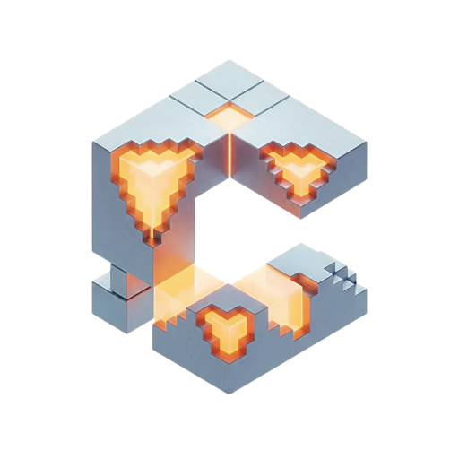
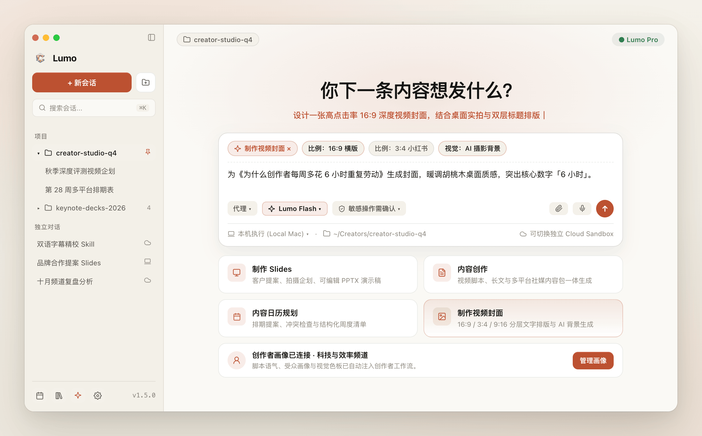
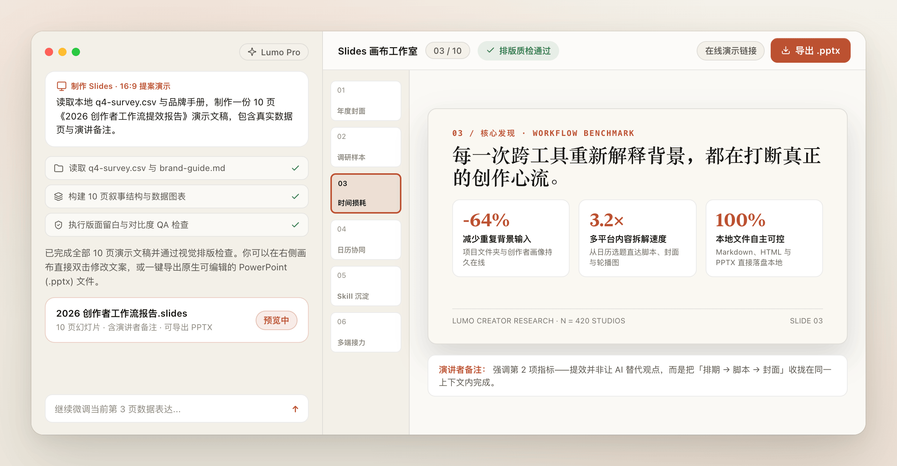
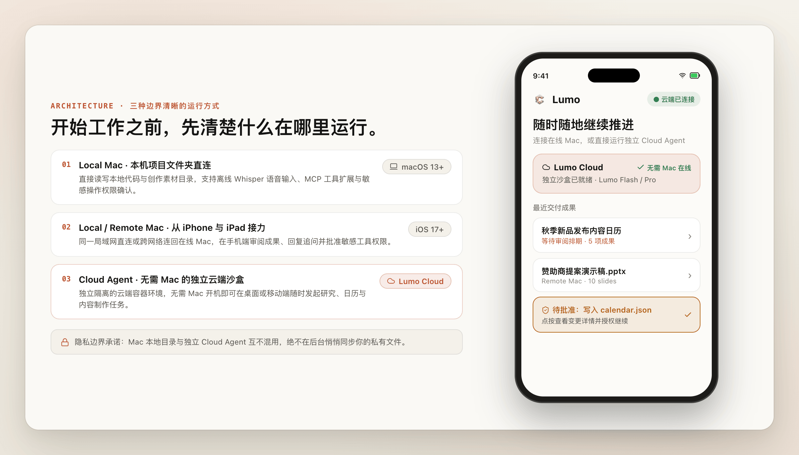

# Lumo

### 从计划到成稿，一个可随身继续的 AI 创作工作台。

调研选题、规划创作者日历、撰写脚本、设计演示稿与视频封面，并把验证有效的方法沉淀为可复用的 **Skill**。 
原生支持 **Mac**，可从 **iPhone 或 iPad** 随时接力，或直接运行独立的 **Cloud Agent**。

**[English](./README.md) · [简体中文](./README.zh-CN.md) · [官方网站](https://getlumo.io) · [使用文档](https://getlumo.io/docs) · [更新日志](./CHANGELOG.md) · [客户支持](https://getlumo.io/support)**

 

 

&nbsp;&nbsp;&nbsp;

需要 Intel 芯片 Mac 安装包或校验哈希？请访问 <a href="https://getlumo.io/download">getlumo.io/download</a>。

 

<picture>
  <source media="(prefers-color-scheme: dark)" srcset="./assets/hero-dark-zh.png" />
  <source media="(prefers-color-scheme: light)" srcset="./assets/hero-light-zh.png" />
  
</picture>

---

## 为什么选择 Lumo

传统聊天工具把创作成果锁在一次性的对话气泡里——每次换个话题都要重新解释频道调性、在多个软件之间反复粘贴改稿、每周从零拼凑封面与排期。**Lumo** 围绕「真实本地文件、结构化创作流与可见的人工决策权」重新设计：

| 核心理念 | 实际工作流改变 |
| :--- | :--- |
| **直接交付作品，而非聊天气泡** | 每一次任务都产出可直接审阅和交付的文件：原生可编辑 `.pptx` 演示文稿、分层高清视频封面、结构化排期日历、Markdown 脚本与交互式 HTML 页面。 |
| **结构化意图与可复用 Skill** | 用直观的**工作流意图胶囊**（画幅比例、发布平台、视觉风格）告别冗长提示词模板，并将验证有效的步骤沉淀为参数化 **Skill**，下周直接复用。 |
| **运行边界透明，关键操作可控** | 任务在 **Local Mac**、**Remote Mac** 还是独立 **Cloud Agent** 上运行一目了然；日历时间冲突会提前标出，敏感工具与文件修改均需经你确认。 |

---

## 分屏 Artifact 创作工作室

左侧保持清晰的推理与调研脉络，右侧实时展开可交互的作品画布。标题太长或重点微调时无需推倒重生成，直接在 **Artifact 工作室**内完成精修：

- **Slides 画布工作室与原生 `.pptx` 导出** — 基于本地调研文档或 CSV 数据生成叙事严谨的 16:9 演示稿，自动完成排版留白与对比度质检；支持画布内双击改字、查看演讲者备注，并一键导出标准 PowerPoint (`.pptx`) 文件。
- **HTML 交互预览与沙盒分享** — 边对话边实时渲染网页原型、数据看板与视觉演示页，支持一键生成安全 HTTPS 在线预览链接便于团队审阅。
- **持久项目上下文与创作者画像** — 输入 `@` 直接引用项目文件，输入 `/` 唤起快捷技能；配置一次**创作者画像**（频道领域、受众特征、内容支柱与视觉色板），后续创作自动贴合你的个人风格。

<picture>
  <source media="(prefers-color-scheme: dark)" srcset="./assets/studio-slides-dark-zh.png" />
  <source media="(prefers-color-scheme: light)" srcset="./assets/studio-slides-light-zh.png" />
  
</picture>

---

## 分层视频封面工作室 & 创作者日历

从周度选题排期一路推进到分镜口播稿与高点击率封面，全程保持上下文不断裂：

- **分层视频封面工作室** — 将 AI 生成的摄影级背景与无损可拖拽文字图层、平台安全区辅助线、AAA 级对比度检测结合，轻松适配 `16:9`（YouTube / B 站）、`3:4`（小红书）与 `9:16`（竖屏短视频）。
- **结构化创作者日历** — 将更新频率、内容支柱与避开日期整理为可检查的周/月排期提案，自动标出日程冲突；点击任一日历条目即可直接关联生成对应脚本与封面。

<picture>
  <source media="(prefers-color-scheme: dark)" srcset="./assets/studio-visuals-dark-zh.png" />
  <source media="(prefers-color-scheme: light)" srcset="./assets/studio-visuals-light-zh.png" />
  
</picture>

---

## 三种边界清晰的运行方式

开始工作之前，先清楚什么在哪里运行。Lumo 在 **Mac**、**iPhone** 与 **iPad** 之间提供三种职责分明的运行模式：

<picture>
  <source media="(prefers-color-scheme: dark)" srcset="./assets/continuity-dark-zh.png" />
  <source media="(prefers-color-scheme: light)" srcset="./assets/continuity-light-zh.png" />
  
</picture>

| 运行模式 | 文件与工具所在位置 | 适用场景 |
| :--- | :--- | :--- |
| **01 · Local Mac（本机执行）** | 直接读写你指定的 macOS 本地文件夹（`~/...`） | 桌面深度创作、本地代码/素材库直连、MCP 工具扩展、离线 Whisper 语音输入及敏感操作权限确认。 |
| **02 · Local / Remote Mac** *（iOS 接力）* | 运行在你的在线 Mac 上，通过同局域网 Wi-Fi 或加密中继连接 | 离开书桌时，用手机或 iPad 查看已生成产物、回复追问并批准敏感工具权限。 |
| **03 · Cloud Agent** *（`Lumo Cloud`）* | 独立隔离的云端托管容器环境 — **无需拥有或开启 Mac** | 随时随地从 iPhone、iPad 或桌面端直接发起选题调研、排期规划与内容创作。 |

> **隐私与工作区边界承诺：** 你的 Mac 本地目录与独立 Cloud Agent 彼此严格隔离，Lumo **绝不会**在后台悄悄上传或自动同步你的私有本地文件夹。

---

## 为高频创作打磨的细节体验

- **Lumo Flash 与 Lumo Pro 双模型引擎** — 日常高频起草使用轻快敏捷的 **Lumo Flash**，复杂长链推理与多页版式构建一键切换至 **Lumo Pro**，登录账号开箱即用，无需繁琐配置。
- **自然语音输入与精选多音色朗读** — 支持 Mac 端离线 **Local Whisper** 或低延迟云端语音识别，解放双手口述复杂创作需求；内置 5 款自然中英朗读音色（`Default`、`Asteria`、`Luna`、`Arcas`、`Orion`），方便随时听稿审校语感。
- **开放的 Skill 体系与 MCP 协议** — 将成熟方法保存至 `~/.lumo/skills` 参数化复用，并在 macOS 上通过 **MCP（Model Context Protocol）** 连接外部知识库与专业工具链。
- **温润克制的亮色与暗色模式** — 采用暖宣纸亮色（`#FAF9F5`）与暖曜石暗色（`#141413`）编辑部美学配色，长时间阅读、审稿与夜间创作依然舒适耐看。

---

## 平台支持与多语言本地化

| 平台 | 系统要求 | 当前公开版本 | 获取方式 |
| :--- | :--- | :--- | :--- |
| **macOS** | macOS 13.0 Ventura 及以上（支持 Apple Silicon 与 Intel） | **v1.5.0** | [下载官方 `.dmg` 安装包](https://cdn.getlumo.io/releases/release/1.5.0/Lumo_1.5.0_arm64.dmg) · 支持签名应用内自动更新 |
| **iOS & iPadOS** | iOS / iPadOS 17.0 及以上 | **v1.4.0** | [前往 Apple App Store 获取](https://apps.apple.com/app/id6789684419) |
| **Windows** | Windows 11 (x64) | *预览测试中* | 关注本仓库 [Releases](https://github.com/TacticSpaceTech/lumo/releases) 获取开放通知 |

**原生 6 语言界面支持：** 简体中文 · English · 日本語 · 한국어 · Español · Português

---

## 常见问题（FAQ）

<strong>Local Mac 与 Cloud Agent 会自动同步我的本地文件吗？</strong>

 
不会——这是刻意设计的安全边界。<strong>Local Mac</strong> 直接操作你电脑上的本地文件夹，而 <strong>Cloud Agent</strong> 运行在独立隔离的云端沙盒中，方便在没有 Mac 时也能独立工作。若想在 iPhone 或 iPad 上继续某台在线 Mac 的任务，请通过 <strong>Local Mac</strong>（同一 Wi-Fi）或 <strong>Remote Mac</strong> 连接该电脑。

<strong>如果没有 Mac，只用 iPhone 或 iPad 可以使用 Lumo 吗？</strong>

 
完全可以。<strong>Lumo iOS 版</strong>原生内置完整的 <strong>Cloud Agent（Lumo Cloud）</strong>支持，无需依赖任何电脑即可独立完成选题调研、日历排期、脚本撰写与成果审阅。

<strong>使用 Lumo 需要自己申请或配置第三方 API Key 吗？</strong>

 
不需要。Lumo 采用开箱即用的一体化服务设计——登录 Lumo 账号即可直接使用 <strong>Lumo Flash</strong>、<strong>Lumo Pro</strong>、云端语音识别、自然音色朗读与 AI 视频封面背景生成，无需自行管理任何第三方密钥或模型端点。

<strong>Lumo 生成的作品支持导出哪些格式？</strong>

 
演示文稿支持一键导出为标准可编辑的 <strong>PowerPoint（<code>.pptx</code>）</strong>；视频封面支持导出高清 <strong>PNG</strong>；脚本、调研笔记与 Skill 均为标准 <strong>Markdown（<code>.md</code>）</strong> 文件；交互式原型支持保存为独立 <strong>HTML</strong> 或生成在线预览链接。

---

## 社区反馈、问题追踪与支持

本仓库是 **Lumo 官方公开展示与用户反馈中心**，用于发布版本动态、收集产品建议与追踪客户端问题：

- **提交 Bug 反馈** — [新建 Bug Report](https://github.com/TacticSpaceTech/lumo/issues/new?template=bug_report.yml)
- **功能建议与新 Skill 许愿** — [提交 Feature Request](https://github.com/TacticSpaceTech/lumo/issues/new?template=feature_request.yml)
- **官方文档与上手指南** — [getlumo.io/docs](https://getlumo.io/docs)
- **账号与订阅支持** — [getlumo.io/support](https://getlumo.io/support)
- **安全漏洞上报** — 请参阅 [SECURITY.md](./SECURITY.md)
- **法律与隐私条款** — [隐私政策](https://getlumo.io/privacy) · [服务条款](https://getlumo.io/terms)

---

  由 <strong>Tactic Space Tech</strong> 用心打造 · <a href="https://getlumo.io">getlumo.io</a>

